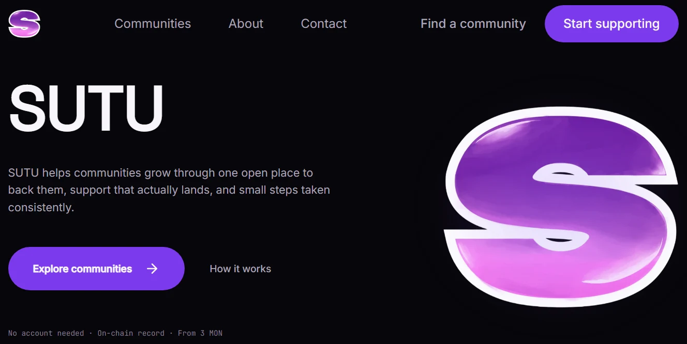

<div align="center">
  

  <h1>SUTU</h1>
  <p><strong>S</strong>upport <strong>U</strong>s <strong>T</strong>ogether</p>
  <p><strong>One place. Every community.</strong></p>

  <p>
    
    
    
    
  </p>
</div>



---

## Overview

SUTU is a consumer-facing platform for discovering and supporting online
communities from a single place.

It is two-sided. Communities register on SUTU and publish what they are
building, with a payout address and funding goals. Supporters find those
communities in one directory and back them without leaving the app. SUTU moves
money from a supporter to a community's own address and keeps the record.

The idea is deliberately plain: someone who wants to back several communities
should not have to search for each one separately, visit a different website,
and learn a different support flow every time. SUTU brings discovery and
support together into one layer.

Blockchain is treated as infrastructure rather than as the interface — it is
there because it makes multi-recipient settlement and a durable record
possible, not because the user asked for jargon. The everyday vocabulary stays
familiar: discover, support, pay, history, profile.

---

## The problem

Two things are fragmented at once, and the friction compounds.

**Discovery is fragmented.** Communities are scattered across Discord, forums,
social posts, and directories. There is no single place to see what a community
is actually building.

**Support is fragmented.** Even after you find one, paying it is a new website,
a new checkout, and often a wallet address copied from a message you cannot
verify later. There is no shared profile, no funding goal, no history, and no
receipt.

The result is a lot of small friction: time lost between tabs, no way to tell
whether money arrived, and no way to keep supporting the same community next
month without starting over. You are asked for trust before you are given
evidence.

---

## Our approach

One support layer, with a short path through it:

```
Find a community  →  choose an amount  →  pay  →  done
```

**Consumer first.** The product is designed for ordinary users, including people
who do not think of themselves as crypto users. Terms like RPC, nonce, gas, and
chain id stay out of the primary journey. `prefers-reduced-motion`, keyboard
navigation, and honest empty states are treated as part of the feature, not as
polish.

**Multi-community support is the differentiator.** A basket holds several
communities and settles them in a single pass, so backing three projects costs
one visit instead of three. It is what separates SUTU from a single-purpose
donation page.

---

## How SUTU works

| Step | Route | What happens |
|---|---|---|
| 1. Discover | `/discover` | Search by name or description, filter by category, sort by supporters or total volume. |
| 2. Open a community | `/communities/[id]` | Profile: description, active projects, funding goals in MON, supporter count, payout address. |
| 3. Choose an amount | `/communities/[id]/support` | The backend returns a quote before anything is signed: gross amount, any active campaign rebate, platform fee, and what is actually payable. |
| 4. Pay | same | Pick a rail: the **demo wallet** — a seeded USD ledger with no gas, for walking the flow during development — or **on-chain MON** on Monad testnet. Creating a donation intent locks the quoted amount so it cannot shift before the signature. |
| 5. Confirm | same | The wallet signs. The transaction hash is reported back so the backend can verify it, and the intent settles to confirmed. |
| 6. Return later | `/my-supports` | Every contribution with its amount, status, date, and transaction hash. |

Backing several communities at once runs through `/basket`: add communities from
any profile, then settle them together in one flow — one transaction and one
confirmation per community.

`/profile` shows the connected wallet, its demo balance, and the routes into
your history and basket.

---

## Key features

- **Community directory** — search, category filter, and sorting over live data
- **Community profiles** — projects, funding goals, supporter counts, and the
  on-chain payout address
- **Quoted support** — the backend returns gross amount, campaign rebate,
  platform fee, and net payable before you sign. Creating a donation intent
  locks that quote, so the amount cannot change between the quote and the
  signature
- **Two payment rails** — real on-chain MON settlement on Monad testnet, plus a
  **demo wallet** that runs the same flow against a seeded USD ledger with no
  gas. The demo wallet is a development and demonstration aid, not a production
  payment method
- **Support basket** — several communities, one flow
- **Support history** — per-record detail including the transaction hash
- **Visible states** — loading, empty, and error states throughout; when the
  backend is unreachable the UI says so and labels the data it is showing as
  sample data rather than passing it off as real

---

## Who it is for

**Supporters**

- People who want to back several communities and are tired of hunting for
  donation addresses across a dozen tabs
- People new to crypto who want to support a cause without first becoming a
  blockchain operator

**Communities**

- Creators and small collectives without a polished support page or a
  dependable way to show what funding went toward
- Groups already building on Monad that need a shared, consumer-facing front
  door
- Any community that can publish a payout address and wants to receive support
  without standing up its own checkout

The two sides meet in the directory: a registered community appears in search
and gets a profile; a supporter backs it without ever handling a raw address.

---

## Technology

| Layer | Choice |
|---|---|
| Framework | Next.js 15.5 (App Router, RSC) |
| UI | React 19 + TypeScript 5.7 (strict) |
| Styling | Tailwind CSS 3.4 |
| Motion | Framer Motion 11 |
| Web3 | wagmi 3 + viem 2 |
| Server state | TanStack Query 5 |
| Icons | lucide-react |
| Backend | SUTU REST API behind a same-origin rewrite |

Typefaces load through `next/font`: **Space Grotesk** for display, **Inter** for
body, **JetBrains Mono** for figures and technical labels.

### Monad integration

SUTU targets **Monad testnet**, chain id `10143`, with two public RPC endpoints
behind a fallback so a rate-limited node cannot hang a confirmation forever.

**Why Monad:** SUTU is being built as a hackathon entry in the Monad ecosystem,
so the chain is a fixed constraint of the brief rather than a result of
benchmarking. The design leans on what the chain makes possible — cheap,
multi-recipient settlement and a durable record — without making the user
engage with any of it.

Being precise about what is and is not on-chain today:

- **On-chain:** a direct transfer from the supporter's wallet to the community's
  registered payout address. The transaction hash is reported to the backend,
  which verifies it against chain before marking the donation confirmed.
- **Server-side, not on-chain:** the quote, the campaign rebate, the platform
  fee, and the locked amount for an intent.
- **Not built yet:** any SUTU smart contract. Contract-based settlement is
  intentionally deferred until the frontend experience is stable, so today SUTU
  moves funds straight to each community's own address rather than routing them
  through a contract it controls.

---

## Current status

This project is under active development. Being specific about what exists:

### Built and working

| Area | Detail |
|---|---|
| Landing | Marketing page with live community data |
| Directory | Search, category filter, sort, responsive card grid |
| Profiles | Projects, funding goals, supporter counts, payout address |
| Support flow | Quote → intent → sign → verify → confirmed |
| Demo wallet | Seeded USD ledger, no gas — **demonstration only**, not a production payment rail |
| On-chain rail | Direct MON transfer to the community's payout address |
| Basket | Several communities settled in one flow |
| History | List and per-record detail with transaction hash |
| Profile | Wallet address, demo balance, entry points |
| States | Loading, empty, error, and a labelled fallback when the backend is down |

### Known gaps

| Gap | Detail |
|---|---|
| **Community self-registration** | Self-registration is the intended model, but no create endpoint or signup flow exists in this repository yet. The directory is currently populated from backend-managed seed data. This is the main gap between the product's two-sided design and what is built. |
| **Multi-community incentive** | The intended incentive for backing several communities at once is not wired up. The basket creates one intent and one transfer per community without requesting a quote, so no basket-level discount is calculated or shown. The rebate that *is* implemented is per-project campaign, and it only appears in the single-community support flow. |
| **Mobile wallet connection** | Only an injected-extension connector is registered, so iOS Safari and Android Chrome cannot connect. The MetaMask SDK connector is the fix; until then the connect button points at a desktop download. |
| **Explorer links** | Transaction detail shows a disabled "View on Explorer" control. |
| **Saved communities** | Placeholder row on the profile page. |
| **Notifications** | No toast or notification system yet. |
| **Contract settlement** | Deferred; see [Monad integration](#monad-integration). |

### Deliberately out of scope for the MVP

Card payments and third-party payment providers, recurring support,
memberships, community campaigns, recommendation systems, community analytics,
and social features. These are documented as later work rather than gaps.

---

## Team

| Name | Role |
|---|---|
| **Wildan** | Project Manager & Fullstack Developer |
| **Raihan** | Backend & Smart Contract Developer |
| **Haidar** | Frontend Developer |
| **Almaira** | UI Designer |

---

## Getting started

```bash
git clone https://github.com/DanKaza/SUTU.git
cd SUTU
npm install
cp .env.example .env.local     # edit if your API key differs
npm run dev                    # http://localhost:3000
```

| Command | What it does |
|---|---|
| `npm run dev` | Dev server |
| `npm run build` | Production build |
| `npm run start` | Serve the production build |
| `npm run lint` | ESLint over the repo |
| `npm run typecheck` | `tsc --noEmit` |

`npm run typecheck && npm run lint` is clean on `main` — worth running before
you push.

## Environment

| Variable | Required | Default in code | Purpose |
|---|---|---|---|
| `NEXT_PUBLIC_SUTU_API_KEY` | yes | `sutu-dev-key` | Sent as `x-api-key` on every request |
| `NEXT_PUBLIC_SUTU_API_ORIGIN` | no | see `.env.example` | Backend origin that `/api/v1` and `/health` proxy to |

These are `NEXT_PUBLIC_*`, so they are inlined at build time. **Restart the dev
server after changing one** — a hot reload will not pick up a new origin.

`API_ORIGIN` is read in `next.config.ts` and nowhere else. The browser only ever
talks to the same-origin `/api/v1/*` path, so there is no CORS surface and the
origin cannot drift between two files.

## Project structure

```
app/
  layout.tsx          Root shell: fonts, providers, GlobalNav + Footer
  page.tsx            Landing — renders <LandingPage /> directly
  globals.css         Design tokens, focus ring, reduced-motion rules
  discover/           Search, category tabs, sort, directory grid
  communities/[id]/   Community profile
  communities/[id]/support/   Two-rail support flow (demo wallet | on-chain)
  basket/             Multi-community basket and checkout
  my-supports/        Support history + per-record detail
  profile/            Wallet profile
  about/  contact/    Static copy

components/
  layout/             Container, GlobalNav, Footer, MotionProvider, BrandLogo, ConnectButton
  landing/            Hero, FoldLight, ParallaxLayer, SupportFlowPreview, section blocks
  community/          DirectoryCard, TopCommunities
  ui/                 Card, Button, Input, Badge, Tabs, CountUp
  support/            AffirmationPop

lib/
  motion.ts           Every transition and variant in the app
  community-data.ts   Live fetch + mock fallback
  api/                Client, endpoints, types, formatters
  web3/               wagmi config, auth context, wallet errors
  mock-data.ts        Seed communities, used only when the API is unreachable

docs/                 Product plan, backend contract, design spec, redesign record
```

## Implementation notes

Two constraints are load-bearing and easy to undo by accident.

**The page shell lives in one file.** `components/layout/container.tsx` owns the
1200px column, and `GlobalNav` and `Footer` consume it too, so content on every
route starts on the same vertical edge as the header. `ContainerNarrow` is the
reading measure nested inside it for pages that should stay narrow. A new route
that skips this reintroduces the misalignment.

**Motion rules live in `lib/motion.ts`.** Two are not stylistic:

1. *Entrances never start at `opacity: 0`.* A zero-opacity element is not
   eligible to be the largest contentful paint, so a fade above the fold pushes
   LCP out by the animation length. Entrances start at `0.001`.
2. *No ambient loops.* Motion is triggered by the reader — on scroll, hover, or
   pointer. The fold's light follows the cursor instead of pulsing on a timer,
   because perpetual motion nobody asked for competes with the copy.

`MotionProvider` sets `MotionConfig reducedMotion="always"`, so
`prefers-reduced-motion` drops transform animations while keeping opacity fades.

**On-chain values are decimal strings.** Every calculation goes through `BigInt`;
`parseFloat` on a wei value loses precision. `lib/api/format.ts` holds the
converters — format at the point of display, never in storage.

## Documentation

| File | What it holds |
|---|---|
| `docs/plan.md` | Product plan: vision, scope, user journey, MVP boundaries |
| `docs/backend.md` | Backend contract, proxy layout, status log |
| `docs/backend_update.md` | Endpoint and auth rules |
| `docs/sutu_desain_spesifikation.md` | Original design specification |
| `docs/redesign-landing.md` | Landing redesign record, measurements, decisions |